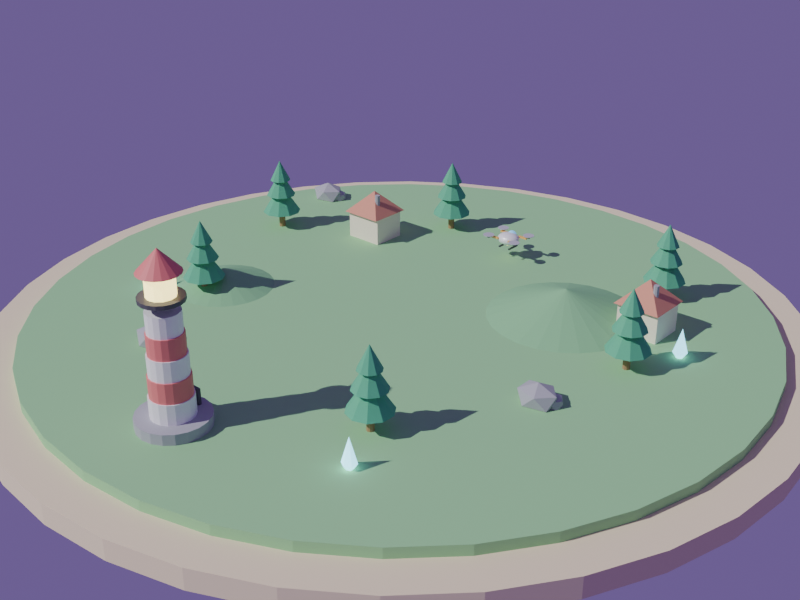

# 星屑デリバリー (Hoshikuzu Delivery)

夕暮れの浮島をホバードローンで飛び回り、星屑を集めて灯台へ届ける、ブラウザで遊べる小さな3Dゲームです。



## 遊び方

- 星屑（光るクリスタル）を **8つ** 集めよう
- 全部集めたら **灯台のビーコン** に近づくと配達完了！
- 制限時間は **120秒**。時間切れになるとゲームオーバー

| 操作 | キー |
|---|---|
| 移動 | WASD / 矢印キー |
| ダッシュ | Shift |
| ホバージャンプ | Space |

- 木・岩・家・灯台にはぶつかります（通り抜けられません）
- 島の外には出られません

## 動かし方

```bash
npm install
npm run dev
```

ブラウザで表示されたURL（通常 http://localhost:5173 ）を開いてください。

本番ビルド:

```bash
npm run build
npm run preview
```

## アセットの再生成 (Blender)

3Dモデルは Blender の Python スクリプトでプロシージャルに生成しています。

```bash
# Blender 4.2 LTS を想定（例: ~/workspace/tools/blender/blender）
~/workspace/tools/blender/blender -b -P assets/scripts/make_assets.py
```

- 生成物: `public/models/*.glb`（ゲームが読み込むモデル）
- ソース: `assets/source/*.blend`
- プレビュー画像: `preview.png`（プロジェクトルート）

## 構成

- `index.html` / `src/main.js` / `src/style.css` — ゲーム本体 (Three.js + Vite)
- `assets/scripts/make_assets.py` — Blender アセット生成スクリプト
- `docs/GAME_DESIGN.md` — ゲームデザイン文書

詳しくは [docs/GAME_DESIGN.md](docs/GAME_DESIGN.md) を参照してください。
